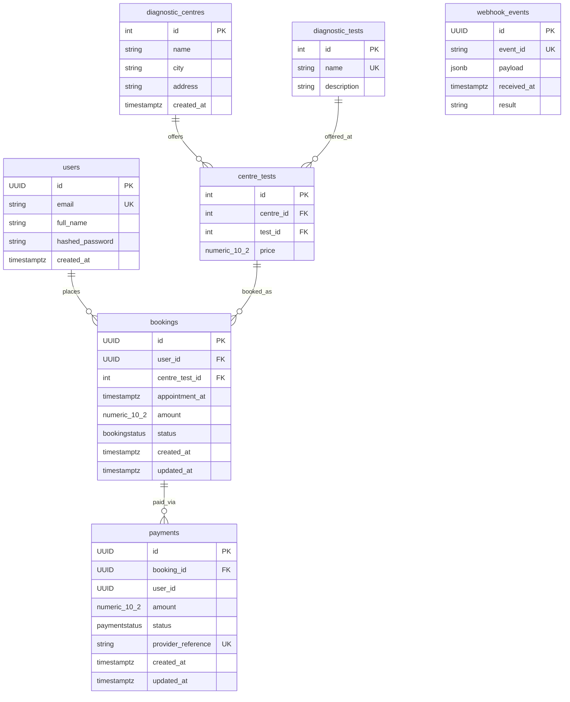

# Eve Diagnostics API

A production-quality REST API for booking diagnostic centre appointments and processing payments, built with **FastAPI**, **PostgreSQL**, and **SQLAlchemy 2.0**.

---

## 1. Overview & Tech Stack

| Layer | Technology |
|---|---|
| Framework | FastAPI 0.142 |
| ORM | SQLAlchemy 2.0 (sync) |
| Migrations | Alembic 1.20 |
| Database | PostgreSQL 16 |
| Validation | Pydantic v2 |
| Auth | JWT (PyJWT) + bcrypt (passlib) |
| Payments | Simulated in-process (80 % success, or `force_outcome`) |
| Webhook security | HMAC-SHA256 signature verification |
| Testing | pytest + FastAPI `TestClient` |
| Containerisation | Docker (multi-stage) + Docker Compose |

**Project layout**

```
app/
  core/          config, security, exceptions, logging
  db/            base declarative, session factory
  models/        SQLAlchemy ORM models
  schemas/       Pydantic request / response schemas
  services/      Business logic (BookingService, PaymentService, WebhookService, …)
  api/
    routers/     Thin FastAPI routers
    deps.py      JWT auth dependency (get_current_user)
    deps_webhook.py  HMAC signature dependency (verify_signature)
alembic/versions/  001 – 005 hand-written migrations
scripts/           seed.py, sign_webhook.py, setup_dbs.py
tests/
```

---

## 2. Running the API

### 2a. With Docker Compose (recommended)

> Postgres is published on host port **5433** to avoid conflicts with a local instance.

```bash
# Build and start api + postgres
docker compose up --build

# The API is now available at http://localhost:8000
# Interactive docs: http://localhost:8000/docs
```

The `api` container automatically runs `alembic upgrade head` before starting
uvicorn, so no manual migration step is needed.

### 2b. Without Docker

**Prerequisites:** Python 3.11, a running PostgreSQL instance.

```bash
# 1. Create and activate virtual environment
python -m venv .venv
.venv\Scripts\activate          # Windows
# source .venv/bin/activate     # macOS / Linux

# 2. Install dependencies
pip install -r requirements.txt

# 3. Configure environment
cp .env.example .env
# Edit .env — set POSTGRES_USER, POSTGRES_PASSWORD, POSTGRES_DB, etc.

# 4. Run migrations
alembic upgrade head

# 5. (Optional) Seed sample data
python scripts/seed.py

# 6. Start the server
uvicorn app.main:app --reload
```

### 2c. Running Tests

Tests require a separate Postgres database (`eve_diagnostics_test` by default).

```bash
# Ensure TEST_DATABASE_URL is set in .env, then:
pytest -v
```

---

## 3. API Endpoints

All endpoints are prefixed with `/api/v1`. Interactive Swagger UI is at
`http://localhost:8000/docs`.

### Auth

| Method | Path | Auth | Description |
|--------|------|------|-------------|
| `POST` | `/auth/signup` | — | Register a new user |
| `POST` | `/auth/login` | — | Get a JWT Bearer token |
| `GET` | `/auth/me` | ✅ JWT | Current user profile |

### Diagnostic Centres

| Method | Path | Auth | Description |
|--------|------|------|-------------|
| `POST` | `/centres/` | ✅ JWT | Create a centre |
| `GET` | `/centres/` | — | List (paginated, filter by `?city=`) |
| `GET` | `/centres/{id}` | — | Centre details + offered tests |
| `POST` | `/centres/{id}/tests` | ✅ JWT | Add a test with a price |
| `GET` | `/centres/{id}/tests` | — | List tests at a centre |

### Diagnostic Tests

| Method | Path | Auth | Description |
|--------|------|------|-------------|
| `POST` | `/tests/` | ✅ JWT | Create a test |
| `GET` | `/tests/` | — | List (paginated) |

### Bookings

| Method | Path | Auth | Description |
|--------|------|------|-------------|
| `POST` | `/bookings/` | ✅ JWT | Create a booking |
| `GET` | `/bookings/` | ✅ JWT | List own bookings (filter by `?status=`) |
| `GET` | `/bookings/{id}` | ✅ JWT | Get booking (404 for other users') |
| `POST` | `/bookings/{id}/cancel` | ✅ JWT | Cancel (409 if terminal state) |

### Payments

| Method | Path | Auth | Description |
|--------|------|------|-------------|
| `POST` | `/payments/` | ✅ JWT | Pay a PENDING booking |
| `GET` | `/payments/{id}` | ✅ JWT | Get payment (404 for other users') |
| `POST` | `/payments/webhook/` | HMAC sig | Provider callback (no JWT) |

---

### curl Examples

#### Sign up

```bash
curl -s -X POST http://localhost:8000/api/v1/auth/signup \
  -H "Content-Type: application/json" \
  -d '{"email":"alice@example.com","password":"Secure123"}'
```

#### Log in and capture the token

```bash
TOKEN=$(curl -s -X POST http://localhost:8000/api/v1/auth/login \
  -F "username=alice@example.com" \
  -F "password=Secure123" | python -c "import sys,json; print(json.load(sys.stdin)['access_token'])")
```

#### Create a booking

```bash
curl -s -X POST http://localhost:8000/api/v1/bookings/ \
  -H "Authorization: Bearer $TOKEN" \
  -H "Content-Type: application/json" \
  -d '{
    "centre_id": 1,
    "test_id": 2,
    "appointment_at": "2027-06-01T09:00:00+05:30"
  }'
```

#### Pay a booking (force SUCCESS for testing)

```bash
curl -s -X POST http://localhost:8000/api/v1/payments/ \
  -H "Authorization: Bearer $TOKEN" \
  -H "Content-Type: application/json" \
  -d '{"booking_id":"<booking-uuid>","force_outcome":"SUCCESS"}'
```

#### Send a signed webhook

```bash
# 1. Generate the signature
python scripts/sign_webhook.py
# Output:
#   Payload: {"event_id":"evt_test_123","provider_reference":"SIM-TESTREF",...}
#   X-Signature: <hex-digest>

# 2. Send the webhook (replace SIG and PAYLOAD with script output)
curl -s -X POST http://localhost:8000/api/v1/payments/webhook/ \
  -H "Content-Type: application/json" \
  -H "X-Signature: <hex-digest>" \
  -d '{"event_id":"evt_test_123","provider_reference":"SIM-TESTREF","status":"SUCCESS","amount":1000.0}'
```

---

## 4. Database Schema

### Entity-Relationship Diagram



### Key Constraints & Indexes

| Table | Constraint / Index | Purpose |
|---|---|---|
| `users` | `UNIQUE(email)` | Prevent duplicate accounts |
| `diagnostic_tests` | `UNIQUE(name)` | Test catalogue integrity |
| `centre_tests` | `UNIQUE(centre_id, test_id)` | One price per centre–test pair |
| `centre_tests` | `CHECK(price > 0)` | No free or negative prices |
| `centre_tests` | `price NUMERIC(10,2)` | Never floats for money |
| `bookings` | `INDEX(user_id)`, `INDEX(status)` | Fast per-user and status queries |
| `payments` | `UNIQUE(provider_reference)` | One payment record per provider tx |
| `webhook_events` | `UNIQUE(event_id)` | Idempotency enforcement at DB level |

---

## 5. State Machines

### Booking Status

```
                  ┌─────────────────────────────────┐
                  │                                 │
       create ──► PENDING ──── payment SUCCESS ──► CONFIRMED
                     │                                 │
                     │◄── payment FAILED ──► FAILED    │
                     │                                 │
                     └─────── cancel ───────────────► CANCELLED ◄─┘

Terminal states: FAILED, CANCELLED
```

Implemented as an explicit map in `BookingService.ALLOWED_TRANSITIONS`:

```python
ALLOWED_TRANSITIONS = {
    PENDING:   {CONFIRMED, FAILED, CANCELLED},
    CONFIRMED: {CANCELLED},
    FAILED:    set(),       # terminal
    CANCELLED: set(),       # terminal
}
```

### Payment Status

```
  initiate ──► PENDING ──► SUCCESS  (booking → CONFIRMED)
                    │
                    └────► FAILED   (booking → FAILED, terminal)
```

---

## 6. Webhook Idempotency Design

Five independent layers protect against duplicate or concurrent webhook delivery:

### 1. HMAC-SHA256 Signature Verification

Every request must include an `X-Signature` header containing the
HMAC-SHA256 hex digest of the **raw request body**, computed with
`WEBHOOK_SECRET`. The dependency `verify_signature` uses
`hmac.compare_digest` (constant-time) to prevent timing attacks.
Requests with a missing or wrong signature get **401** before any
business logic runs.

### 2. Unique `event_id` in `webhook_events`

Each event carries a provider-assigned `event_id`.
`WebhookService` opens a **savepoint** (`db.begin_nested()`) and
`INSERT`s a row into `webhook_events`. If a `UNIQUE` violation is raised
(same `event_id` already recorded), the savepoint is rolled back and the
handler returns **200 `already_processed`** immediately — no payment or
booking is touched.

### 3. `SELECT … FOR UPDATE` Row Locks

After confirming the event is new, the service locks the `Payment` row
and then the `Booking` row with `with_for_update()`. Concurrent threads
delivering the same event race on step 2 (the savepoint). The one that
wins the `INSERT` proceeds; all others are already bounced at that point.
If a second thread somehow reaches the `FOR UPDATE` (e.g., a different
event for the same payment), it will block until the first transaction
commits.

### 4. State Transition Rules

Before mutating anything the service checks:

| Payment state | Webhook status | Action |
|---|---|---|
| Same as webhook | any | `no_change` — record result, return 200 |
| `PENDING` | `SUCCESS` / `FAILED` | Apply; move booking via `ALLOWED_TRANSITIONS` |
| Final (`SUCCESS`/`FAILED`) | conflicting | `ignored_conflict` — log warning, return 200 |
| Booking in terminal state | any | `ignored_conflict` — return 200 |

Returning 200 for conflicts tells the provider to **stop retrying**,
which is the correct behaviour for irreversible conflicts.

### 5. Single Transaction

The `webhook_events` INSERT, the `Payment` update, and the `Booking`
update all happen inside one database transaction. Either all succeed or
none do, leaving the system in a consistent state.

---

## 7. Design Assumptions

| # | Assumption |
|---|---|
| 1 | **Failed payment is terminal.** A `FAILED` payment moves the booking to `FAILED` permanently. Users must create a new booking to retry. |
| 2 | **Price is snapshotted at booking time.** `booking.amount` is copied from `CentreTest.price` when the booking is created. Subsequent price changes do not affect existing bookings or payments. |
| 3 | **404 for other users' resources.** `GET /bookings/{id}` and `GET /payments/{id}` return 404 (not 403) when the resource belongs to another user, preventing existence leakage. |
| 4 | **Centre creation is open to any authenticated user.** There is no admin or staff role; any JWT-holding user may create centres and tests. |
| 5 | **Webhook payments are normally already settled.** `POST /payments/` settles synchronously. Webhooks exist for async provider callbacks; the no-op path handles the common case where the payment is already final. |
| 6 | **`force_outcome` is for testing only.** It should be removed or guarded behind a feature flag before production. |

---

## 8. What I Would Improve With More Time

| Area | Improvement |
|---|---|
| **Webhook retries** | Use **Celery** + Redis to queue outbound webhook acknowledgements; implement exponential back-off with a dead-letter queue for failed deliveries. |
| **Outbox pattern** | Persist domain events to a transactional outbox table so webhook dispatch is atomic with the business transaction and survives process crashes. |
| **Refresh tokens** | Add short-lived access tokens with a long-lived refresh token endpoint to reduce exposure without forcing frequent re-login. |
| **Admin / staff roles** | Add a `role` column to `users` and protect centre / test creation behind a staff-only dependency. |
| **Stale PENDING cleanup** | A scheduled Celery beat job (or `pg_cron`) to expire PENDING bookings older than N hours, freeing appointment slots. |
| **Redis caching** | Cache `GET /centres/` and `GET /tests/` results with short TTLs to reduce read load on Postgres. |
| **Rate limiting** | Add per-IP and per-user rate limits (e.g., `slowapi`) on auth endpoints to mitigate brute-force attacks. |
| **Structured logging** | Replace `print` / default logging with `structlog` emitting JSON, shipped to a log aggregator (Loki / CloudWatch). |
| **OpenTelemetry tracing** | Wire up the already-installed `opentelemetry-api` to trace requests end-to-end across the FastAPI → Postgres boundary. |
| **Integration test suite** | Run the full pytest suite against a real Postgres Docker container in CI (GitHub Actions service container) to catch migration and locking issues early. |
